# Multimodal Fault Diagnosis! | The Big Core Convolution Opens a New Era in Vision!

Time-frequency image + multimodal features of one-dimensional time series signal combined with RepLKNet + BiGRU-GATT classification model!
\tPreface
This issue introduces a multimodal fault diagnosis innovative model, which is based on the CVPR2022 Visual Topical Conference paper "RepLKNet", suitable for various fault diagnosis fields, power quality disturbance signal classification tasks, various acoustic signals, electroencephalogram signals, etc.!
Innovative model! Don't miss out on the opportunity to have a thesis or dissertation!
Provide five time-frequency image transformation methods including Markov Transition Function (MTF), Recursive Plot (RP), Gram Matrix (GAF), Continuous Wavelet Transform (CWT), and Short Time Fourier Transform (STFT), which can flexibly replace the time-frequency image types in multimodal features!
1. Related explanations of the innovative model
● Dataset: CWRU West Reserve University Bearing Dataset
● Environment Framework: Python 3.9, PyTorch 2.1 and above can be run.
● Time-frequency image transformation: Provides five methods of time-frequency image transformation.
● Accuracy: 100% on the test set.
● Usage Object: Paper requirements, graduation design requirements.
● Code Guarantee: The code comments are detailed and ready to run.
\t\tNote: We also provide a model explanation (for learning network architecture) and parameter tuning guidance! Students requiring graduation projects or writing small papers must see this, as the modules are rich, innovative, and performance-optimized!!
2. Multimodal Innovation Model Introduction
2.1 Introduction to the Model Innovation Points:
The multimodal feature fusion model, which combines time-frequency images and one-dimensional sequential signals and employs RepLKNet and BiGRU-GlobalAttention for classification, effectively integrates visual features with temporal sequences. It is a very powerful model architecture that fully leverages the advantages of multimodal features.
\t  
(1) Multimodal Fusion:
This model integrates time-frequency images and one-dimensional sequential signals for multimodal fusion, fully leveraging the complementary nature of these two types of data. Time-frequency images are visualized through continuous wavelet transform (CWT), capturing the frequency and temporal characteristics of the signal. Meanwhile, one-dimensional sequential signals retain the original time-dependent information, making them suitable for processing with recurrent neural networks (RNN) or Bidirectional Graph Convolutional Networks (BiGRU). By fusing these two features:
The time-frequency image captures the high-frequency and low-frequency trends in the signal, aiding in identifying fault characteristics in the frequency domain.
The one-dimensional sequential signal preserves the time-dependent characteristics of the signal, reflecting the dynamic evolution of faults over time.
This dual-channel data fusion enables the model to simultaneously utilize time, frequency, and image features, significantly enhancing the accuracy of fault classification.
(2) RepLKNet for feature extraction from time-frequency images
In our feature extraction from time-frequency images, we introduce RepLKNet (Re-parameterized Large Kernel Network), a convolutional neural network (CNN) using large convolutional kernels. The advantage of RepLKNet lies in its ability to capture larger local features:
Large convolutional kernels can effectively extract long-term contextual information from time-frequency images, such as the long-term frequency changes in the signal.
Through reparameterization techniques, RepLKNet maintains the efficiency of convolutional calculations during training while enhancing the generalization capability of the model, contributing to improving the accuracy of classification tasks.
This innovation allows the model to capture more high-level information from time-frequency image features, enabling the classification model to perform exceptionally well in complex signal environments.
- (3) BiGRU Network with GlobalAttention Optimization for One-Dimensional Time Series Signals
- In processing one-dimensional time series signals, we utilize the BiGRU (Bidirectional Gated Recurrent Unit) to extract temporal features. To further enhance feature extraction, we introduce the GlobalAttention mechanism, which is advantageous in:
  - The BiGRU, through bidirectional processing, can simultaneously capture the forward and backward dependencies of the signal, allowing the model to better understand the hidden information within the time series.
  - The GlobalAttention mechanism dynamically assigns importance weights for different time steps, making the model focus on key moments of information while ignoring noise or unimportant periods.
  - This innovative design enables the BiGRU to more effectively extract critical features during one-dimensional time series signal processing, significantly improving the accuracy of signal classification.
- (4) Advantage of Feature Fusion
- In the model, the multimodal fusion part extracts both time-frequency image features and one-dimensional signal features processed by BiGRU-GATT. We adopt a feature concatenated fusion approach to combine these two types of features. Compared to traditional models that only use single mode features, the fused features perform better in classification tasks, mainly due to:
  - The time-frequency image and time-series signals provide different perspectives of feature information. The former provides frequency domain features, while the latter retains time-dependent characteristics. The combination of the two can more comprehensively reflect the fault characteristics of the signal.
  - Through feature fusion, the model is more robust in capturing fault features across different modes, especially in complex fault signal environments. The fused features can better handle noise interference and signal changes.
  - This feature fusion strategy allows our model to maintain high-efficiency and accurate classification performance in various fault modes, enhancing its robustness and generalization ability in practical applications.
- Model Effectiveness Demonstration
- (1) Model Training Visualization
(2) Model Evaluation
\t  
(3) Confusion Matrix
\t  
(4) Classification Label Visualization
(5) Original Data t-SNE Feature Visualization
(6) t-SNE feature visualization after model training:
\t  
The model classification effect is significant, with an accuracy of 100% in 50 epochs. Through innovative designs in multiple modalities integration, RepLKNet time-frequency image feature extraction, GlobalAttention optimized BiGRU, and feature fusion strategies, the model performs exceptionally well in fault signal classification tasks. This multi-modal approach that integrates temporal, frequency, and spatial features is particularly suitable for complex industrial fault diagnosis scenarios and has broad application prospects. The results are evident, and the innovation is high!
3. Multimodal Innovation Model Download
Click to download: Complete original data, Python code
Previously Featured Content:
Python-Case Western Reserve University (CWRU) Bearing Data Interpretation and Classification Process
Python Bearing Fault Diagnosis (I) Short-Time Fourier Transform STFT
Python Bearing Fault Diagnosis (II) Continuous Wavelet Transform CWT
Python Bearing Fault Diagnosis (III) Empirical Mode Decomposition EMD
Pytorch-LSTM bearing fault one-dimensional signal classification (I)
Pytorch-CNN bearing fault one-dimensional signal classification (II)
Pytorch-Transformer bearing fault one-dimensional signal classification (III)
Python Bearing Fault Diagnosis (IV) Failure Classification Based on EMD-CNN
Python Bearing Fault Diagnosis (5) Fault Classification Based on EMD-LSTM
Python Bearing Fault Diagnosis (VI) Failure Classification Based on EMD-Transformer
Python Bearing Fault Diagnosis (VII) - Fault Classification Based on EMD-CNN-LSTM
Python Bearing Fault Diagnosis (VIII) Parallel Model Based on EMD-CNN-GRU for Fault Classification
Fault Identification Model for Bearing Based on FFT + CNN - BiGRU-Attention: Attention to Time and Frequency Characteristics
Fault Identification Model for Bearing Based on FFT + CNN - Transformer: Attention to Time and Frequency Characteristics
Python Bearing Fault Diagnosis (IX) Parallel Model Based on VMD+CNN-BiLSTM for Fault Classification
Python Bearing Fault Diagnosis (X) Parallel Model Based on VMD+CNN-Transformer for Fault Classification
Python Bearing Fault Diagnosis (11) Parallel Model Based on VMD+CNN-BiGRU-Attention for Fault Classification
Cross Attention Fusion of Time and Frequency Features with FFT + CNN - BiLSTM-CrossAttention Bearing Fault Identification Model
Cross Attention Fusion of Time and Frequency Features with FFT + CNN-Transformer-CrossAttention Bearing Fault Identification Model
Introduction to Python Bearing Fault Diagnosis
Python Bearing Fault Diagnosis (13) Super-strong Machine Learning Identification Model Based on Fault Signal Feature Extraction
Python Bearing Fault Diagnosis (14) Highly Innovative Fault Identification Model
Python Bearing Fault Diagnosis (15) One-Dimensional Fault Signal Identification Model Based on CNN-Transformer
Python Bearing Fault Diagnosis (16) Highly Innovative Fault Identification Model (II)
SCI 1st Region Highly Innovative Bearing Fault Diagnosis Model!
Python Bearing Fault Diagnosis (18) Innovative Diagnosis Model Based on CNN-TCN-Attention
Highly Innovative Bearing Fault Diagnosis Model Based on GADF+Swin-CNN-GAM
Attention Magic Modification | Super-strong Bearing Fault Diagnosis Model!
Bearing Faults—Cross Attention Innovation Model Complete Kit
Python Bearing Fault Diagnosis (19) Innovative Diagnosis Model Based on Transformer-BiLSTM
END

## Images

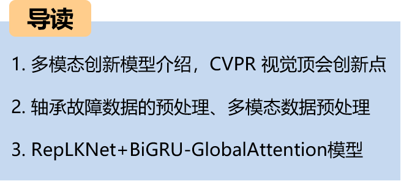
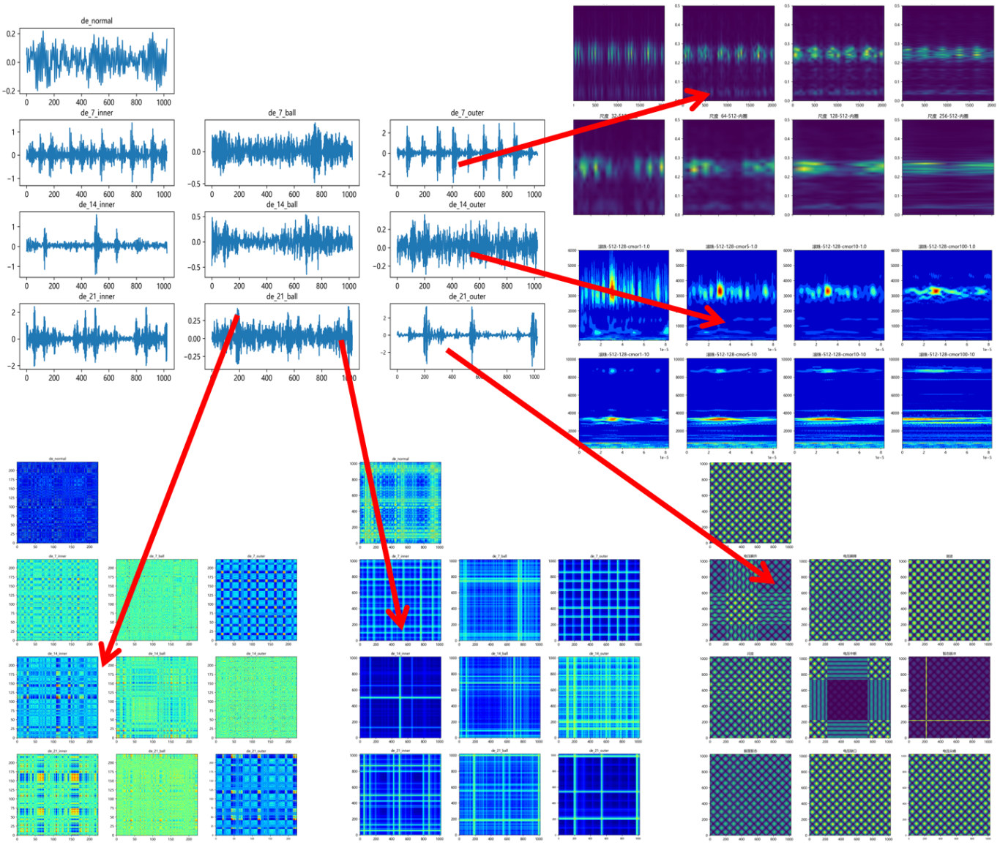
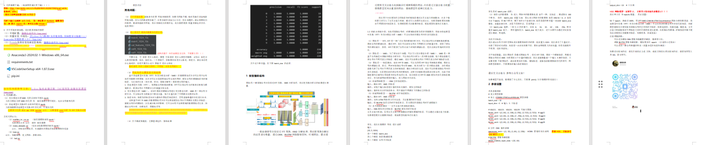
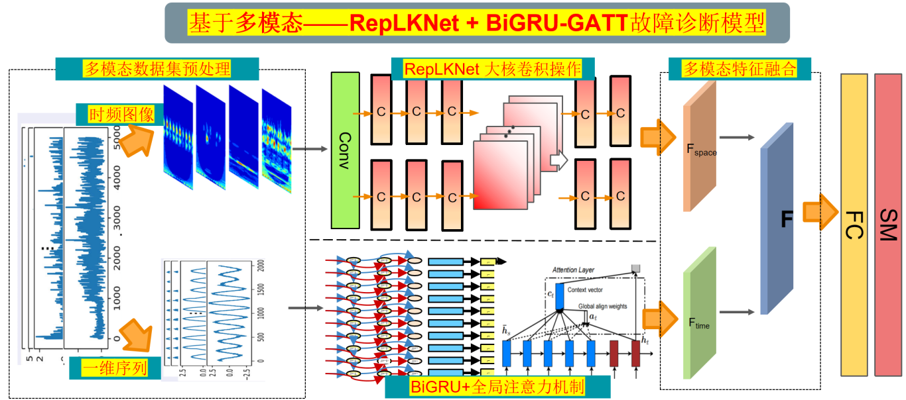
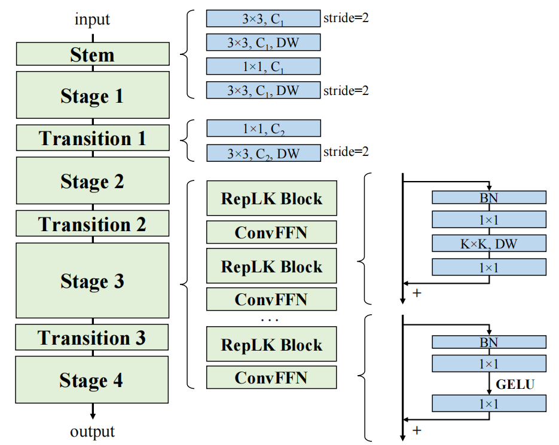

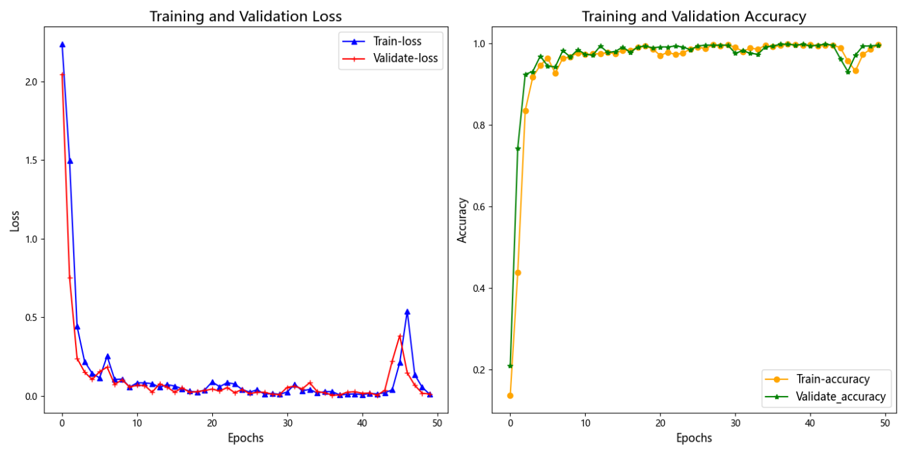
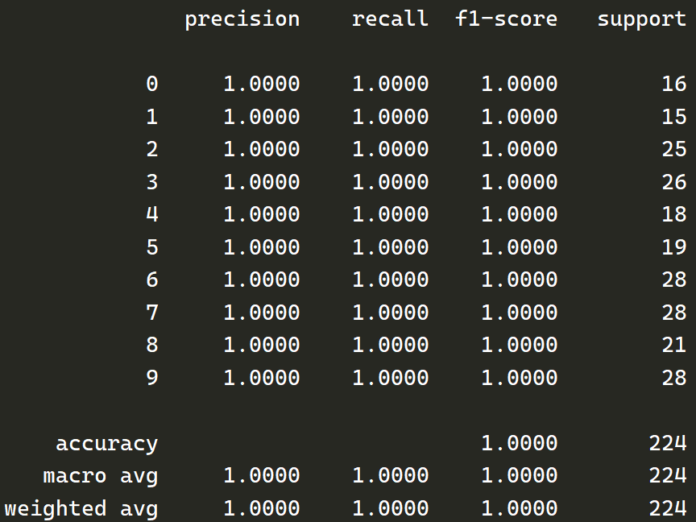
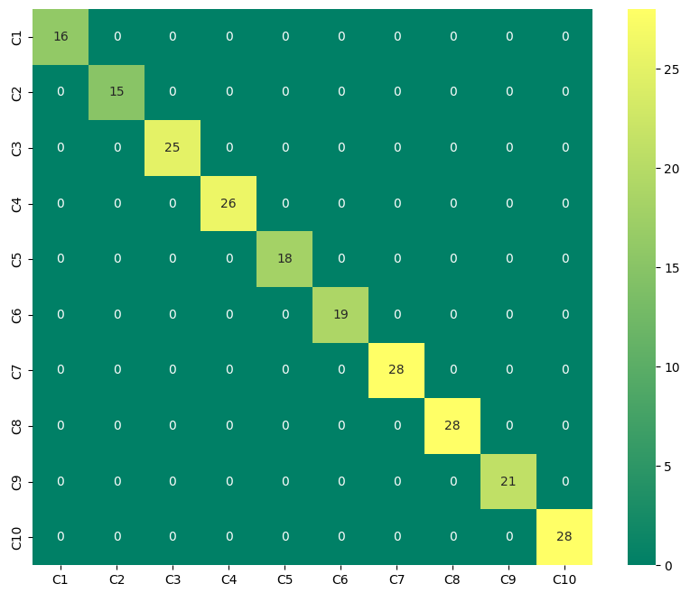
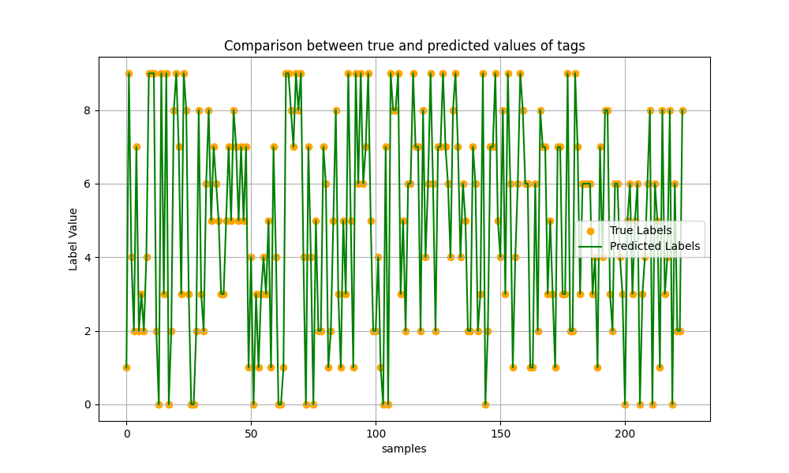
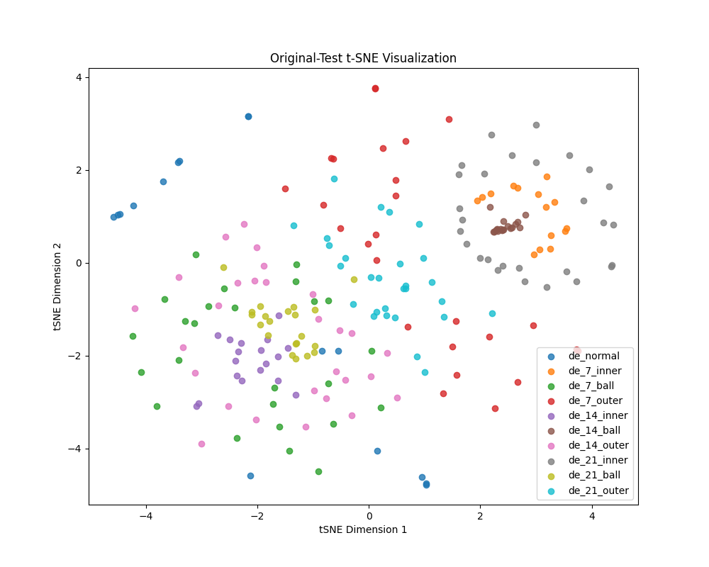
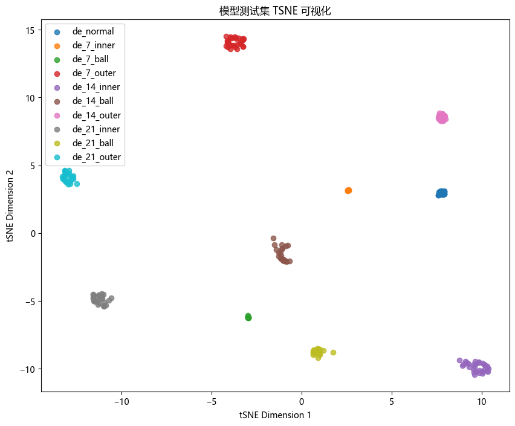
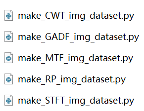
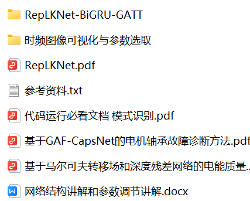

<!-- PAYMENT_BLOCK -->

## Get this dataset

- Payment link (Stripe): [Buy now](https://buy.stripe.com/3cs8yP7sY87d0vu9AB)
- Payment QR code: 

<!-- /PAYMENT_BLOCK -->
